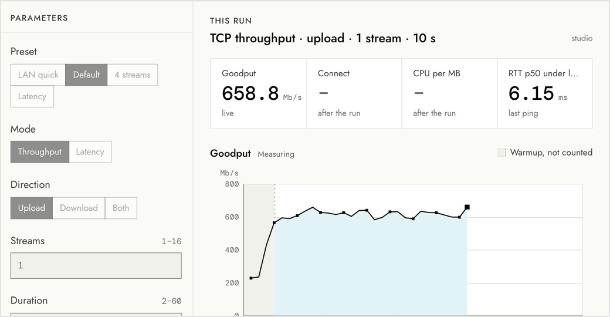
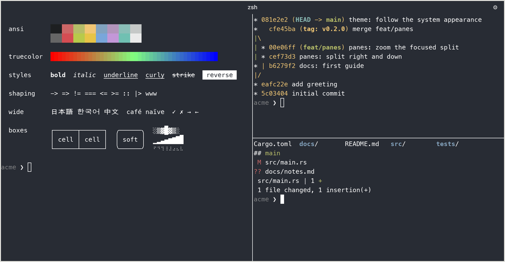
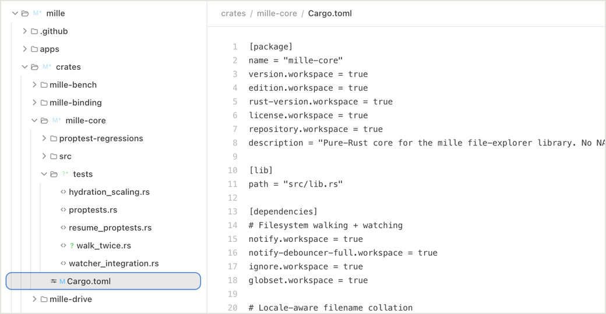
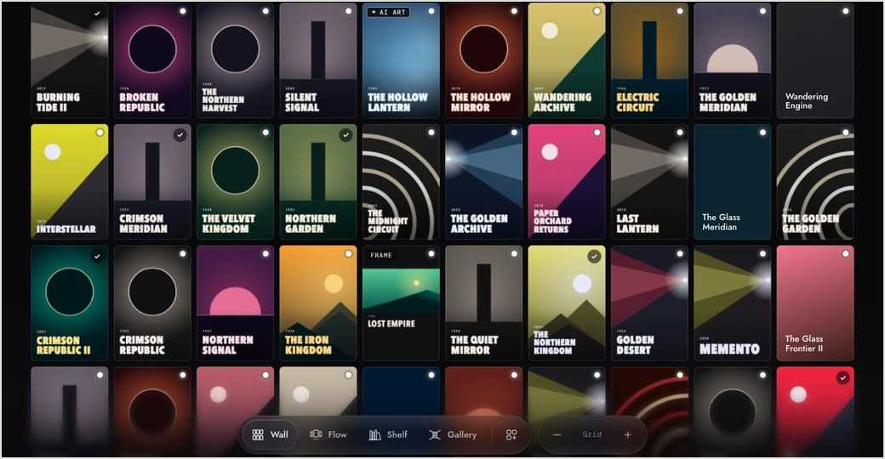

  <picture>
    <source media="(prefers-color-scheme: dark)" srcset="readme/hero-dark.svg">
    
  </picture>

  <b>Three libraries and an app, all open source.</b> 
  A mesh network, a terminal and a file tree for the app you're building. 
  And flux, a media server built on two of them.

 

<table>
  <tr>
    <td width="50%" valign="top">
      <a href="https://github.com/vibecook-dev/truffle"><picture><source media="(prefers-color-scheme: dark)" srcset="readme/plate-truffle-dark.svg"></picture></a>
      <a href="https://github.com/vibecook-dev/truffle"><picture><source media="(prefers-color-scheme: dark)" srcset="readme/shot-truffle-dark.png"></picture></a>
      Direct connections between your own devices, on top of Tailscale. TCP, UDP, QUIC, WebSocket and HTTP, with no server to run. 
      <a href="https://github.com/vibecook-dev/truffle"><b>Repository</b></a>&nbsp;&nbsp;·&nbsp; <a href="https://vibecook-dev.github.io/truffle/">Docs</a>&nbsp;&nbsp;·&nbsp; <a href="https://www.npmjs.com/package/@vibecook/truffle">npm</a>&nbsp;&nbsp;·&nbsp; <a href="https://crates.io/crates/truffle">crates.io</a>
    </td>
    <td width="50%" valign="top">
      <a href="https://github.com/vibecook-dev/ghosttea"><picture><source media="(prefers-color-scheme: dark)" srcset="readme/plate-ghosttea-dark.svg"></picture></a>
      <a href="https://github.com/vibecook-dev/ghosttea"><picture><source media="(prefers-color-scheme: dark)" srcset="readme/shot-ghosttea-dark.png"></picture></a>
      A terminal to embed in your app. Ghostty's terminal core, a Rust daemon, and GPU renderers for Electron and iOS. 
      <a href="https://github.com/vibecook-dev/ghosttea"><b>Repository</b></a>&nbsp;&nbsp;·&nbsp; <a href="https://vibecook-dev.github.io/ghosttea/">Website</a>&nbsp;&nbsp;·&nbsp; <a href="https://www.npmjs.com/package/@vibecook/ghosttea-react">npm</a>&nbsp;&nbsp;·&nbsp; <a href="https://crates.io/crates/ghosttea">crates.io</a>
    </td>
  </tr>
  <tr>
    <td width="50%" valign="top">
      <a href="https://github.com/vibecook-dev/mille"><picture><source media="(prefers-color-scheme: dark)" srcset="readme/plate-mille-dark.svg"></picture></a>
      <a href="https://github.com/vibecook-dev/mille"><picture><source media="(prefers-color-scheme: dark)" srcset="readme/shot-mille-dark.png"></picture></a>
      A file explorer for your Electron app. A Rust engine walks, watches and searches the folder, and React draws only the rows on screen. 
      <a href="https://github.com/vibecook-dev/mille"><b>Repository</b></a>&nbsp;&nbsp;·&nbsp; <a href="https://vibecook-dev.github.io/mille/">Website</a>&nbsp;&nbsp;·&nbsp; <a href="https://www.npmjs.com/package/@vibecook/mille">npm</a>
    </td>
    <td width="50%" valign="top">
      <a href="https://github.com/vibecook-dev/flux"><picture><source media="(prefers-color-scheme: dark)" srcset="readme/plate-flux-dark.svg"></picture></a>
      <a href="https://github.com/vibecook-dev/flux"><picture><source media="(prefers-color-scheme: dark)" srcset="readme/shot-flux-dark.jpg"></picture></a>
      A fast, private media server for the films and shows you own. Written in Rust, and in alpha. 
      <a href="https://github.com/vibecook-dev/flux"><b>Repository</b></a>&nbsp;&nbsp;·&nbsp; <a href="https://vibecook-dev.github.io/flux/">Website</a>&nbsp;&nbsp;·&nbsp; <a href="https://github.com/vibecook-dev/flux/releases">Download</a>
    </td>
  </tr>
</table>

Screenshots, not mocks: truffle's benchmark app on its demo data, ghosttea's demo app, mille's <code>FileTree</code>, and flux's Wall lens.

## How they fit

  <picture>
    <source media="(prefers-color-scheme: dark)" srcset="readme/fit-dark.svg">
    
  </picture>

truffle is the network under the other three. You can use any one of them without the rest.

All four are MIT licensed and still 0.x, so their APIs can change between releases.

 

  <a href="https://github.com/jamesyong-42">
    <picture>
      <source media="(prefers-color-scheme: dark)" srcset="readme/james-yong-dark.svg">
      
    </picture>
  </a>

  vibecook is made by <a href="https://github.com/jamesyong-42">James Yong</a>.

